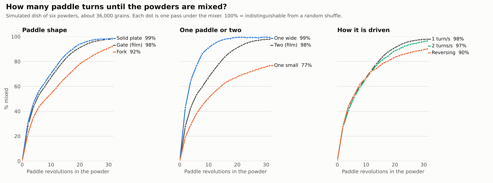
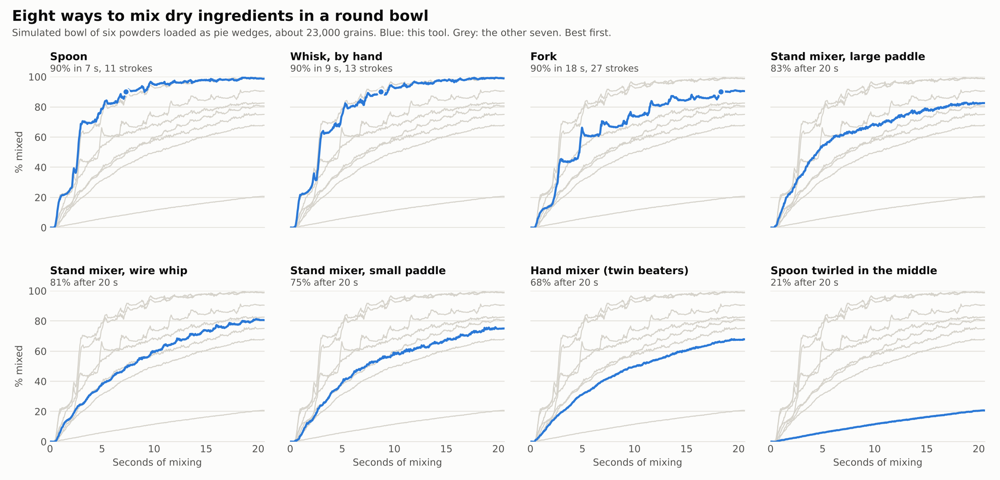
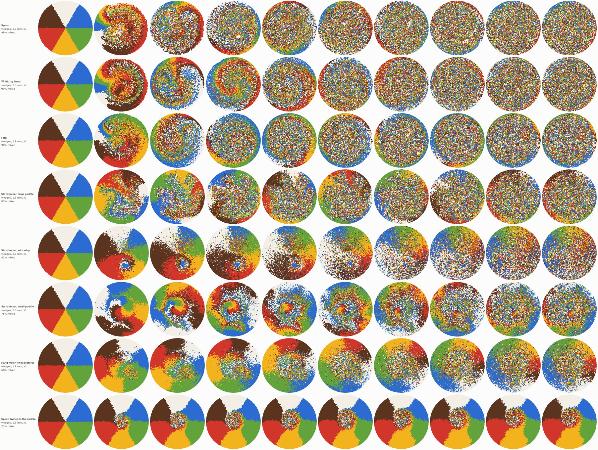
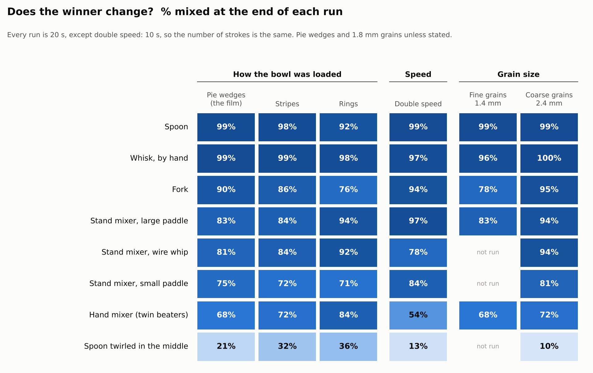

# Powder mixing on a conveyor (Blender)

A looping, "how mixed is it?" animation: six dried powders (tiny cubes) sit in
lanes in a glass dish, ride a conveyor under a twin-paddle stand mixer, get
stirred for about two seconds, leave, and come round again. Each pass mixes
them a little more; an on-screen counter shows the pass number and a measured
"% mixed".

Nothing here is hand-animated. The grains are a real granular simulation, and
the percentage is measured from the simulated grains.

## Files

| File | What it does |
| --- | --- |
| `simulate.py` | Granular physics (position-based dynamics with friction, numba). Writes `cache/particles.pc2` plus `cache/meta.npz` / `meta.json` (animation channels, mixing curve). |
| `build_scene.py` | Builds the whole Blender scene from the cache (conveyor, glass dish, mixer, lights, camera, overlay), saves a `.blend`, and can render stills or the animation with Cycles. |
| `experiment.py` | Runs a set of mixer designs through `simulate.py` and tabulates % mixed against paddle revolutions. |
| `plot_experiment.py` | Draws `experiments/mixing_vs_revolutions.png` from that table. |
| `experiments/` | Results of both experiments (CSV, per-frame curves, charts). |
| `powder_mixer_preview_480p.mp4` | Low-sample CPU preview of the conveyor film (854x480, 8 samples). |
| `pbd.py` | The granular solver both simulations share. |
| `tools.py` | The kitchen tools: shapes, collider points, and how each is moved round the bowl. |
| `bowl_sim.py` | One tool stirring six powders in a round bowl. |
| `tournament.py`, `plot_tournament.py`, `topviews.py` | Run the tools head to head (plus loading, speed and grain-size sets), chart the results, draw top-down snapshots. |
| `bowl_scene.py` | Blender scene for one or two bowls under mixer heads, from `bowl_sim.py` caches. |
| `match_spoon_vs_stand_mixer_480p.mp4` | First head-to-head test clip (854x480, 8 samples, 12.5 s). |
| `make_film.py`, `film_compose.py`, `film_score.py` | The knockout film: simulate the bracket, render each match, lay the frames over the data strip and cards, synthesize the score. |
| `make_short.py`, `make_thumbs.py` | The vertical Short and the three thumbnails. |
| `the_mix_off_PREVIEW_720p.mp4` | The knockout film, preview quality (3:34, 1280x720). |
| `same_spoon_two_ways_SHORT.mp4` | Vertical Short: the first quarter-final. |
| `thumbnails/` | Thumbnail options A, B, C. YouTube copy is in `../copy/mix_off_YOUTUBE.md`. |
| `stills/` | Test frames. |

`cache/`, `renders/` and `.blend` files are generated, so they are git-ignored.

## Quick start

```bash
pip install bpy numba numpy matplotlib   # or use Blender's own Python for build_scene.py
```

```bash
python simulate.py                   # ~62k grains, 10 passes, about 35 min on one core
```

```bash
python build_scene.py --save mixer.blend --still 1 300 1100
```

```bash
python build_scene.py --anim --res 3840x2160 --samples 96 --gpu
```

```bash
ffmpeg -framerate 24 -i renders/frames/f_%04d.png -c:v libx264 -crf 16 -pix_fmt yuv420p mixer.mp4
```

Inside Blender instead of the `bpy` module:

```bash
blender -b -P build_scene.py -- --save mixer.blend
```

Then open `mixer.blend` and render as usual. The grains are one mesh of points
with a Mesh Cache modifier (the `.pc2` file, path stored relative to the
`.blend`) and a Geometry Nodes modifier that puts a cube on every point.

## Useful knobs

`simulate.py`

- `--grain 1.5` grain size in mm. Smaller is more powder-like and slower:
  1.5 is about 62k grains, 1.2 about 120k, 1.0 about 210k.
- `--passes 10` number of trips through the mixer.
- `--rev 1.5` paddle speed (rev/s) and `--t-mix 1.6` seconds under the mixer.
  Together they set the turns per pass (about 2.9 by default).
- `--paddles 2` twin intermeshing paddles, or `1` for a single paddle on the
  centre line.
- `--style gate|plate|fork` paddle shape: windowed frame, solid plate, tines.
- `--alternate` reverse the paddles every pass (mixes worse, see below).
- `--ingredients 6` number of lanes (up to 8 colours in the palette).
- `--max-dt 1.0` longest solver time step in ms. Do not raise it for anything
  you intend to quote: see "Solver time step" below.
- `--set KEY=VALUE` override any geometry or timing value, e.g. `--set paddle_r=24`.

`build_scene.py`

- `--res 3840x2160`, `--samples 96`, `--gpu`, `--motion-blur`
- `--no-hud` drop the pass / % mixed overlay
- `--real-glass` physically refracting dish. Correct, but the rounded corners
  and base act as lenses and show streaky reflected grains along the dish
  edges. The default is a clean glass that does not bend light.
- `--elev`, `--azim`, `--dist`, `--aperture` camera placement and depth of field
- `--start`, `--end` render a frame range. Rendering never overwrites existing
  frames, so it is resumable and several processes can share one job.

Colours are the `PALETTE` list at the top of `build_scene.py`.

## What "% mixed" means

The dish is cut into 7.5 mm sample columns. For each ingredient we take the
standard deviation of its share across the samples:

- `s0`: fully separated (where the video starts)
- `sr`: a perfectly random mix, which still varies a little from scoop to
  scoop because a scoop holds a finite number of grains
- `s`: now

`mixed = (s0 - s) / (s0 - sr)`, averaged over the six ingredients. 0% is the
untouched lanes; 100% means samples are indistinguishable from a random
shuffle. This is the standard-deviation form of the Lacey mixing index.

## What the film's run shows

62,355 grains, 10 passes, about 2.9 paddle turns in the powder per pass:

| Pass | 0 | 1 | 2 | 3 | 4 | 5 | 6 | 7 | 8 | 9 | 10 |
|---|---|---|---|---|---|---|---|---|---|---|---|
| Paddle turns | 0 | 2.9 | 5.9 | 8.8 | 11.7 | 14.6 | 17.6 | 20.5 | 23.4 | 26.3 | 29.3 |
| % mixed | 0 | 35 | 52 | 63 | 72 | 79 | 85 | 90 | 94 | 96 | 97 |

- **The first turns do the most.** Each pass removes only a fraction of the
  unevenness that is left, so the curve flattens and never quite reaches 100%.
- **It looks mixed before it is.** The surface is confetti several passes
  before the count stops finding lopsided samples.

## Mixer design experiment

`python experiment.py` then `python plot_experiment.py`. About 36,000 grains
(1.8 mm), 16 passes of 1.95 paddle turns each, 1 ms solver step. Paddle turns
needed to reach each level:

| Design | 50% | 80% | 90% | 95% | After 31 turns |
|---|---|---|---|---|---|
| Twin gate paddles (the film's) | 6 | 16 | 20 | 23 | 98% |
| Twin solid plates | 6 | 14 | 18 | 21 | 99% |
| Twin forks (3 tines a side) | 10 | 21 | 29 | not reached | 92% |
| One wide gate paddle, dish shaped to match | 4 | 8 | 10 | 14 | 99% |
| One gate paddle, same size as the twins | 10 | not reached | not reached | not reached | 77% |
| Twin gate, reversing every pass | 6 | 18 | 31 | not reached | 90% |
| Twin gate, double speed (2 turns/s) | 6 | 16 | 21 | 29 | 97% |

Turn counts are read at pass ends, so they are good to about one pass (2 turns).



What it says:

- **Coverage beats everything.** One small paddle leaves bands down both sides
  that it never touches and stalls at 77%. One wide paddle that sweeps the
  whole dish is the fastest design tested, quicker than two paddles: with two,
  each mostly keeps its own half and exchange happens only where they overlap.
- **Blade area matters more than blade shape.** Solid plates and windowed gates
  are within a couple of points of each other; forks, with far less area, need
  about half as many turns again.
- **Turns count, not speed.** Doubling the speed leaves the curve within a few
  points at every pass. The film's run at 1.5 turns/s lands on the same curve
  too (35% at 2.9 turns, 52% at 5.9).
- **Reversing each pass costs you.** It keeps up for the first ten turns, then
  falls behind and is at 90% where same-direction stirring is at 98%.

Limits: one run per design (a repeat with a different random fill, at a coarser
solver step, differed by about one point); equal-size frictional spheres with
no cohesion, so no clumping and no size segregation; one loading pattern (lanes
along the belt).

### Solver time step

Position-based dynamics lets stirred grains jitter by about `g*dt^2` each step,
and that jitter mixes them on its own. With the twin gate paddles at 1 turn/s
the first pass read:

| Time step | 4.2 ms | 2.1 ms | 1.0 ms | 0.5 ms |
|---|---|---|---|---|
| % mixed after pass 1 | 55 | 34 | 28 | 25 |

Everything above uses 1 ms (`--max-dt 1.0`), where the answer has nearly
stopped moving; expect the true first-pass figure to be a few points lower
still. The first cut of the film used about 4 ms and overstated the mixing
(51% after one pass). The coarse step also over-compressed the bed: 11.5 mm
deep instead of 15 mm.

## Kitchen head-to-head (round bowl)

Eight ways of mixing dry ingredients, each given the same bowl of six powders.

```bash
python tournament.py --set base load speed grain      # about 2.5 h on 4 cores
```

```bash
python plot_tournament.py
```

```bash
python bowl_sim.py --tool spoon && python bowl_sim.py --tool paddle_large
```

```bash
python bowl_scene.py --left cache/bowl/spoon --right cache/bowl/paddle_large --anim --res 3840x2160 --samples 96 --gpu
```

### The rig

The bowl is a half-scale model of a 22 cm kitchen bowl: 110 mm across, flat
floor, rounded corner, powder 14 mm deep. It stays still. Every tool hangs from
a rotor that turns about the bowl's axis, which covers every kitchen motion:

| Contestant | How it moves | Rate |
|---|---|---|
| Spoon, fork, whisk by hand | Fixed to the rotor, face leading, radius breathing in and out so the stir spirals through the whole bowl | 1.5 strokes/s |
| Stand mixer: large paddle, small paddle, wire whip | Planetary: orbits the bowl while spinning the other way on its own shaft | 0.8 orbits/s, 2.4 turns/s on the shaft |
| Hand mixer | Two counter-rotating beaters carried round the bowl | 5 turns/s, 0.4 laps/s |
| Spoon twirled in the middle | Spins on the spot | 1.5 turns/s |

Why the bowl does not spin: turning the bowl under a fixed tool is the same
relative motion, but it also flings the powder outward, and it is not what
people do with a spoon. The large paddle spans 62% of the bowl, as a real flat
beater does.

### Result (pie-wedge loading, 23,273 grains of 1.8 mm, 20 s each)

| Tool | % mixed after 20 s | Reaches 90% after |
|---|---|---|
| Spoon, stirred in a spiral | 99 | 11 strokes (7 s) |
| Whisk, by hand | 99 | 13 strokes (9 s) |
| Fork | 90 | 27 strokes (18 s) |
| Stand mixer, large paddle | 83 | not in 16 orbits |
| Stand mixer, wire whip | 81 | not in 16 orbits |
| Stand mixer, small paddle | 75 | not in 16 orbits |
| Hand mixer (twin beaters) | 68 | not in 8 laps |
| Spoon twirled in the middle | 21 | never |





Each tool mixes only where it sweeps. The spoon and whisk cover the whole bowl
and drag powder round it. The small paddle leaves a core in the middle it never
touches; the twin beaters mix the centre while intact wedges circle the rim;
the stand-mixer tools drag the outer ring round in bulk (the "scrape down the
sides" problem). A spoon twirled in the middle mixes a 30 mm disc and nothing
else. A spoon dragged round the same circle every stroke, with no spiral, was
actually the quickest on wedges (90% in 7 strokes), but it has no way to move
powder in or out, so it was not tested as a contestant.

### Does the winner change?



- **Loading.** The hand whisk is 98 to 99% whatever the loading; the spoon dips
  to 92% on rings. Rings (which need powder moved in and out) are where the
  stand mixer shines: the large paddle goes from 83% to 94%.
- **Speed.** Hand tools give the same result per stroke at double speed (spoon
  99%, whisk 97%), as the literature says. The machines do not: the large
  paddle improves to 97%, because at that speed it starts throwing powder, and
  the hand mixer drops to 54%, because its beaters fling powder away from
  themselves.
- **Grain size.** The top two are unchanged from 1.4 to 2.4 mm. The fork gets
  worse with finer grains (95, 90, 78%): more of the powder slips between the
  tines. The stand-mixer tools do better with coarse grains.

### Limits

- One run per case. The speeds are my choices for "typical", and the per-second
  figures depend on them; the per-stroke figures do not.
- The model is half scale under full gravity, so by Froude scaling one model
  second is about 1.4 real seconds and 1.5 strokes/s here is about one stroke a
  second in a real bowl.
- A real hand mixer's slowest setting is two to three times faster than 5
  turns/s. That speed is beyond what the solver handles well, and the
  double-speed run suggests it would mix worse, not better.
- Equal-size, dry, non-sticky spheres: no clumping, no dust cloud, no size
  segregation. Wires are one grain thick. Grains cannot leave the bowl.
- "% mixed" is rescaled so the bowl as loaded reads 0% for every loading
  pattern (thin rings otherwise start at 26%).

## The knockout film

`the_mix_off_PREVIEW_720p.mp4`: the eight methods in a knockout. Each round
loads the bowl differently (pie wedges, stripes, rings), so every match is new
footage; each contestant gets 15 seconds; whoever is more mixed at the end goes
through. The bracket is decided by the simulations, not written into the code.

| Match | Load | Result |
|---|---|---|
| Quarter-final 1 | wedges | Spoon 98% beat spoon twirled in the middle 17% |
| Quarter-final 2 | wedges | Stand mixer, large paddle 77% beat wire whip 72% |
| Quarter-final 3 | wedges | Whisk 98% beat hand mixer 60% |
| Quarter-final 4 | wedges | Fork 84% beat stand mixer, small paddle 66% |
| Semi-final 1 | stripes | Spoon 96% beat stand mixer, large paddle 78% |
| Semi-final 2 | stripes | Whisk 97% beat fork 79% |
| Final | rings | Whisk 94% beat spoon 88% |

These are 15-second runs, so the figures are a little lower than the 20-second
table above. The final was close: the spoon reached 90% at 13.4 s and then
slipped back as it lifted out.

```bash
python make_film.py sims          # 14 simulations, about 40 min on 4 cores
```

```bash
python make_film.py render        # 7 x 376 frames; about 3.5 h on a 4-core CPU at 960x420, 8 samples
```

```bash
python make_film.py compose && python make_film.py finish
```

For an upload-quality version, render larger on a GPU and compose again; the
overlay scales with nothing to change:

```bash
python make_film.py render --res 2560x1120 --samples 64 --frames renders/film_hq
```

`bowl_scene.py` does not pass `--gpu` through `make_film.py` yet; add it to the
command in `stage_render` on a GPU machine.

What is and is not final about the preview:

- The 3-D picture is 960x420 at 8 samples, scaled up 1.33x. Text, charts and
  top-down views are drawn at full resolution.
- The score is synthesized in `film_score.py` (marimba-like pattern, pad, a bell
  per result) and levelled to about -16 LUFS. It has been checked for level and
  clipping only; nobody has listened to it.
- The cold open borrows four seconds of semi-final 1.

## What the literature says

Verified at abstract level unless marked "full text". No paper gives a general
"N turns for X% mixed" table, and nothing was found on spoon or fork strokes
for dry powders.

- **Exponential approach, counted in revolutions.** Variance between samples
  decays roughly exponentially towards the random-mix floor, with a rate
  constant per revolution. Lacey 1954, *J. Appl. Chem.* 4:257,
  doi:10.1002/jctb.5010040504; Muzzio group, "Characterization of the
  Performance of Bin Blenders, Part 1", *Pharm. Technol.* 2004 (full text).
- **Speed does not matter, turns do.** V-blender, 66 micron glass beads: mixing
  per revolution unchanged from 8 to 24 rpm, and faster at 40% fill than 60%.
  Brone, Alexander & Muzzio 1998, *AIChE J.* 44:271, doi:10.1002/aic.690440206.
  Bladed mixer simulations: 2 to 100 rpm changes the rate only slightly.
  Chandratilleke et al. 2010, *Ind. Eng. Chem. Res.* 49:5467,
  doi:10.1021/ie901581t.
- **Blade count.** Two or three blades mix better than one or four.
  Boonkanokwong et al. 2016, *Powder Technol.* 302:333,
  doi:10.1016/j.powtec.2016.08.064 (via the author's dissertation abstract).
- **Twin paddle mixer.** 264,600 glass beads, 40 rpm: steady uniformity after
  15 s, about 10 revolutions (our conversion), for paddle angles up to 45
  degrees; 60 degrees needs about 25 s. Jadidi et al. 2023, *Processes* 11:733,
  doi:10.3390/pr11030733 (full text).
- **Direction of loading matters enormously.** Horizontal bladed mixer: Lacey
  index 0.99 in 4 rotations across the section but 68 along the axis.
  Pourandi, Ostanin & Weinhart 2026, arXiv:2604.07082 (preprint, full text). A
  tote blender loaded side by side was still under-mixed after 240 revolutions.
  Muzzio, PQRI workshop slides 2005 (full text).
- **What industry calls mixed.** Relative standard deviation between samples of
  5.0% or less, every sample within 10% of the mean. PQRI Blend Uniformity
  Working Group recommendation, 2003 (full text). The random floor for six
  equal ingredients is `RSD = sqrt(5/n)`: 22% for 100-grain samples, and 5%
  needs about 2,000 grains per sample.
- **Reversal un-mixes** in fluids and suspensions: below a strain of about 1 at
  30% solids, sheared particles return to where they started each cycle. Pine
  et al. 2005, *Nature* 438:997, doi:10.1038/nature04380 (full text). No paper
  was found on reversing paddles in a powder.
- **Card shuffling, for comparison.** Distance from random for 52 cards after 1
  to 10 riffle shuffles: 1.000, 1.000, 1.000, 1.000, 0.924, 0.614, 0.334,
  0.167, 0.085, 0.043. Nothing, then halving. Bayer & Diaconis 1992, *Ann.
  Appl. Probab.* 2:294, doi:10.1214/aoap/1177005705 (full text).
- **Stirring rods in fluid.** Efficient (chaotic) stirring needs three or more
  rods moved in a braiding pattern. Boyland, Aref & Stremler 2000, *J. Fluid
  Mech.* 403:277.

## Rendering notes

Measured on a 4-core CPU with no GPU: 854x480 at 8 samples takes about 5 s a
frame, and one 3840x2160 frame at 32 samples takes several minutes. The full
1,244-frame film at 4K needs a GPU (`--gpu`).
