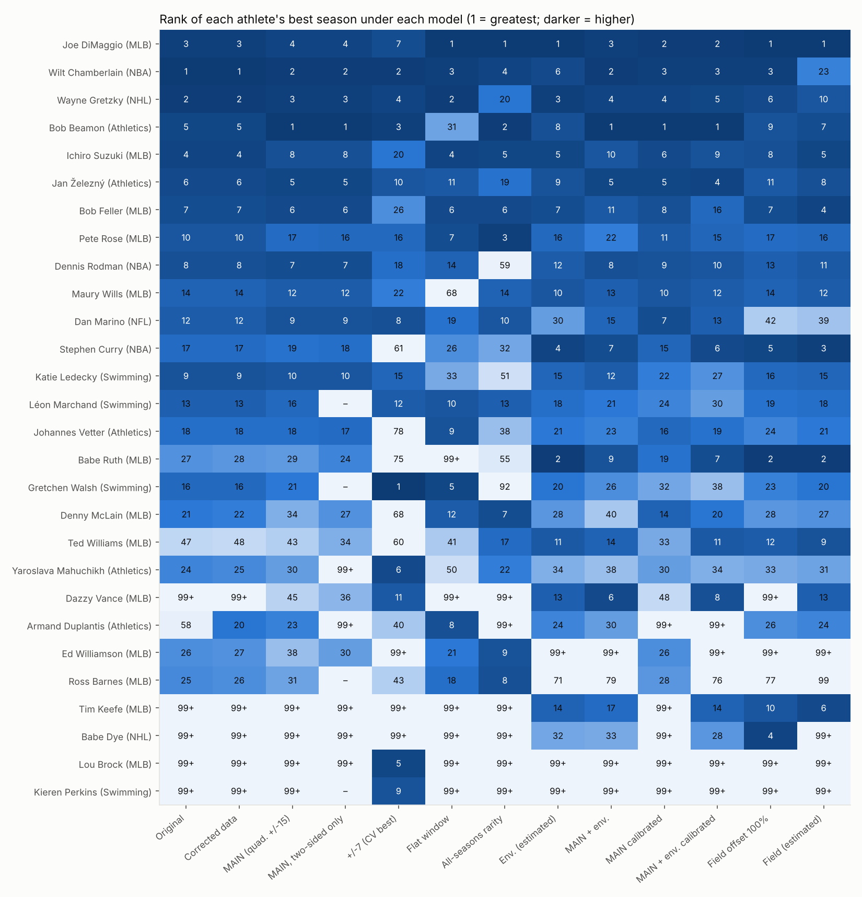
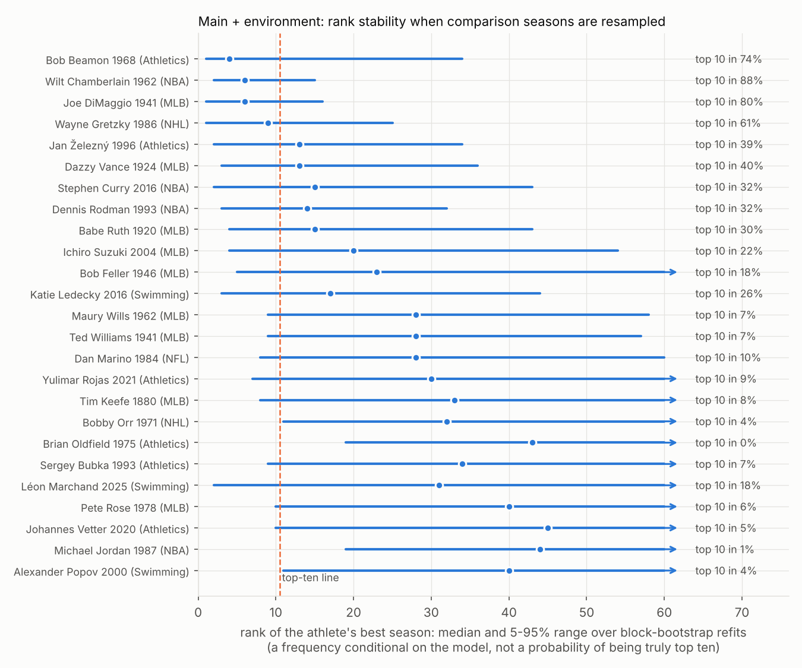
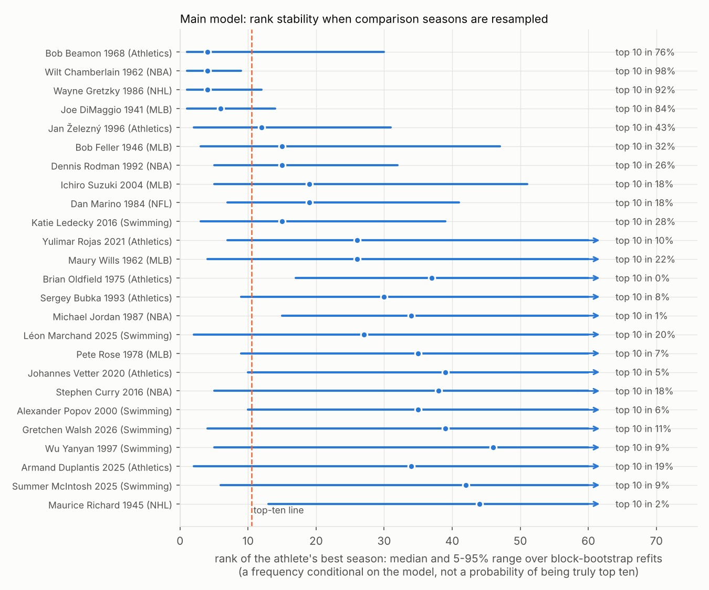
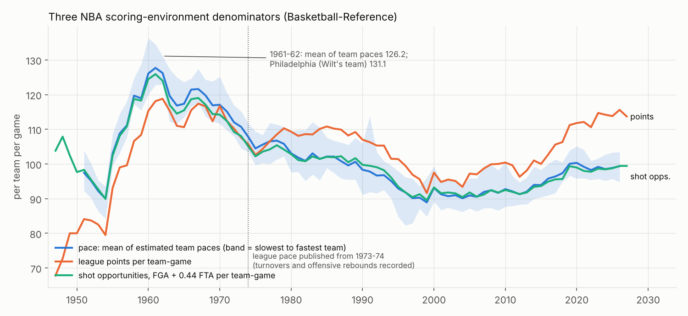
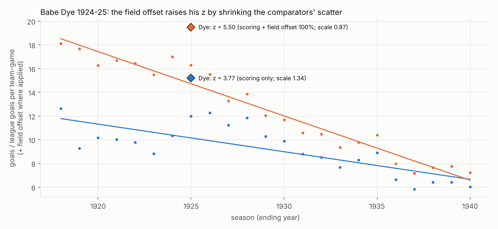
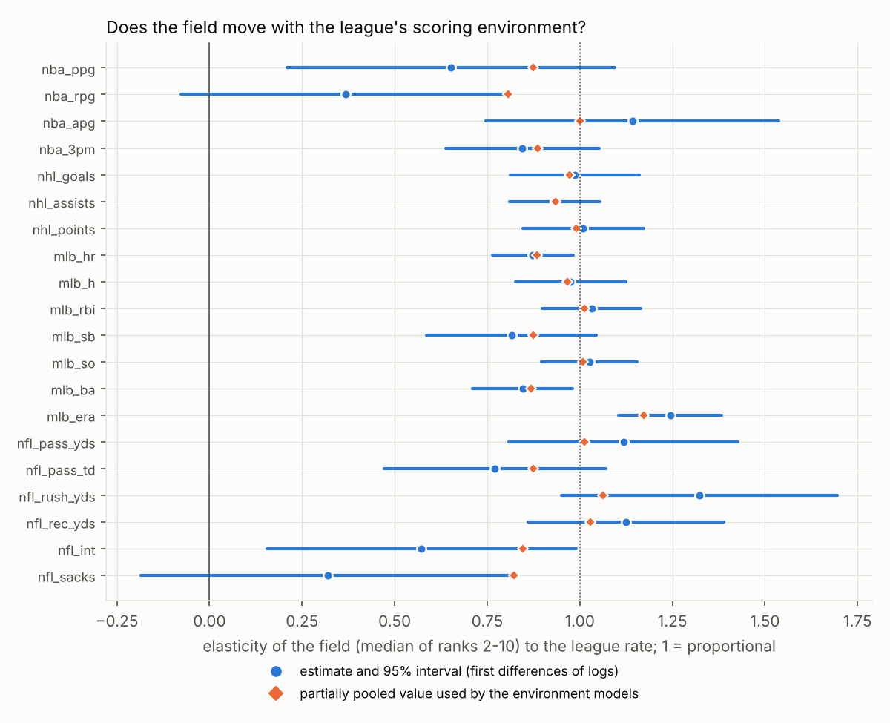

# Top-ten robustness

Generated by `analysis/report.py` from `outputs/`. Seasons are labelled by the year they end (1985-86 = 1986).
Scores are z (standard deviations above the comparison baseline) unless the column says calibrated (-log10 p).

The ranking keeps **each athlete's best season**. "Rank" in the bootstrap tables is that page rank.

## 1. The current top ten against the improved models

| # | Original | A1_corrected | A2_main | E3_main_env | A2_main_cal | E3_main_env_cal |
|---|---|---|---|---|---|---|
| 1 | Wilt Chamberlain 1962 (7.73) | Wilt Chamberlain 1962 (7.73) | Bob Beamon 1968 (7.80) | Bob Beamon 1968 (7.80) | Bob Beamon 1968 (4.24) | Bob Beamon 1968 (4.20) |
| 2 | Wayne Gretzky 1986 (7.50) | Wayne Gretzky 1986 (7.50) | Wilt Chamberlain 1962 (7.66) | Wilt Chamberlain 1962 (7.05) | Joe DiMaggio 1941 (3.92) | Joe DiMaggio 1941 (3.90) |
| 3 | Joe DiMaggio 1941 (7.20) | Joe DiMaggio 1941 (7.20) | Wayne Gretzky 1986 (7.53) | Joe DiMaggio 1941 (7.01) | Wilt Chamberlain 1962 (3.68) | Wilt Chamberlain 1962 (3.42) |
| 4 | Ichiro Suzuki 2004 (5.17) | Ichiro Suzuki 2004 (5.17) | Joe DiMaggio 1941 (7.01) | Wayne Gretzky 1986 (6.47) | Wayne Gretzky 1986 (3.59) | Jan Železný 1996 (3.16) |
| 5 | Bob Beamon 1968 (5.02) | Bob Beamon 1968 (5.02) | Jan Železný 1996 (5.95) | Jan Železný 1996 (5.95) | Jan Železný 1996 (3.16) | Wayne Gretzky 1986 (3.15) |
| 6 | Jan Železný 1996 (4.99) | Jan Železný 1996 (4.99) | Bob Feller 1946 (5.40) | Dazzy Vance 1924 (5.83) | Ichiro Suzuki 2004 (2.84) | Stephen Curry 2016 (3.03) |
| 7 | Bob Feller 1946 (4.71) | Bob Feller 1946 (4.71) | Dennis Rodman 1992 (5.28) | Stephen Curry 2016 (5.69) | Dan Marino 1984 (2.80) | Babe Ruth 1920 (2.95) |
| 8 | Dennis Rodman 1992 (4.50) | Dennis Rodman 1992 (4.50) | Ichiro Suzuki 2004 (5.10) | Dennis Rodman 1993 (5.68) | Bob Feller 1946 (2.73) | Dazzy Vance 1924 (2.85) |
| 9 | Katie Ledecky 2016 (4.47) | Katie Ledecky 2016 (4.47) | Dan Marino 1984 (5.03) | Babe Ruth 1920 (5.56) | Dennis Rodman 1992 (2.59) | Ichiro Suzuki 2004 (2.85) |
| 10 | Pete Rose 1978 (4.46) | Pete Rose 1978 (4.46) | Katie Ledecky 2016 (4.86) | Ichiro Suzuki 2004 (5.27) | Maury Wills 1962 (2.57) | Dennis Rodman 1993 (2.72) |

- **Original** is the published ranking. It is reproduced exactly by `tests/test_reproduction.py`.
- **A1_corrected** changes only the data: stable IDs, logged repairs, and scoring every tied leader.
- **A2_main** is the main peer-dominance model: corrected data, ±15 seasons, and a quadratic trend chosen by
  cross-validation within the brief's ±15 window.
- **E3_main_env** adds a scoring/opportunity environment adjustment for the big four. Its elasticities are estimated
  and partially pooled.
- **_cal** columns rank by a sensitivity model: a pooled-exponential category tail, -log10 P(a season leader of the
  category exceeds z). This is not a GPD fit (section 5).

## 2. Every other variant (top ten names)

| # | A1_w7 | A1_w10 | A1_w20 | A1_flat | A2_w7 | A2_twosided | B1_allseasons | B2_allseasons_main | E1_env_ratio | E2_env_power | F_ratio_field50 | F_ratio_field100 | F_ratio_field_estimated |
|---|---|---|---|---|---|---|---|---|---|---|---|---|---|
| 1 | Gretchen Walsh 2026 | Bob Beamon 1968 | Wilt Chamberlain 1962 | Joe DiMaggio 1941 | Gretchen Walsh 2026 | Bob Beamon 1968 | Joe DiMaggio 1941 | Bob Beamon 1968 | Joe DiMaggio 1941 | Joe DiMaggio 1941 | Joe DiMaggio 1941 | Joe DiMaggio 1941 | Joe DiMaggio 1941 |
| 2 | Bob Beamon 1968 | Wayne Gretzky 1986 | Joe DiMaggio 1941 | Wayne Gretzky 1986 | Wilt Chamberlain 1962 | Wilt Chamberlain 1962 | Bob Beamon 1968 | Joe DiMaggio 1941 | Babe Ruth 1920 | Babe Ruth 1920 | Babe Ruth 1920 | Babe Ruth 1920 | Babe Ruth 1920 |
| 3 | Wayne Gretzky 1986 | Gretchen Walsh 2026 | Wayne Gretzky 1986 | Wilt Chamberlain 1962 | Bob Beamon 1968 | Wayne Gretzky 1986 | Pete Rose 1978 | Pete Rose 1978 | Wayne Gretzky 1986 | Wayne Gretzky 1986 | Wilt Chamberlain 1962 | Wilt Chamberlain 1962 | Stephen Curry 2016 |
| 4 | Wilt Chamberlain 1962 | Wilt Chamberlain 1962 | Bob Beamon 1968 | Ichiro Suzuki 2004 | Wayne Gretzky 1986 | Joe DiMaggio 1941 | Wilt Chamberlain 1962 | Wilt Chamberlain 1962 | Stephen Curry 2016 | Stephen Curry 2016 | Wayne Gretzky 1986 | Babe Dye 1925 | Bob Feller 1946 |
| 5 | Dan Marino 1984 | Joe DiMaggio 1941 | Pete Rose 1978 | Gretchen Walsh 2026 | Lou Brock 1974 | Jan Železný 1996 | Ichiro Suzuki 2004 | Bob Feller 1946 | Ichiro Suzuki 2004 | Ichiro Suzuki 2004 | Stephen Curry 2016 | Stephen Curry 2016 | Ichiro Suzuki 2004 |
| 6 | Yaroslava Mahuchikh 2024 | Dan Marino 1984 | Ichiro Suzuki 2004 | Bob Feller 1946 | Yaroslava Mahuchikh 2024 | Bob Feller 1946 | Bob Feller 1946 | Ichiro Suzuki 2004 | Bob Feller 1946 | Wilt Chamberlain 1962 | Ichiro Suzuki 2004 | Wayne Gretzky 1986 | Tim Keefe 1880 |
| 7 | Joe DiMaggio 1941 | Maury Wills 1962 | Jan Železný 1996 | Pete Rose 1978 | Joe DiMaggio 1941 | Dennis Rodman 1992 | Denny McLain 1968 | Alexander Popov 2000 | Tim Keefe 1880 | Bob Feller 1946 | Babe Dye 1925 | Bob Feller 1946 | Bob Beamon 1968 |
| 8 | Kieren Perkins 1994 | Dennis Rodman 1992 | Yulimar Rojas 2022 | Armand Duplantis 2026 | Dan Marino 1984 | Ichiro Suzuki 2004 | Ross Barnes 1876 | Brian Oldfield 1975 | Bob Beamon 1968 | Bob Beamon 1968 | Bob Feller 1946 | Ichiro Suzuki 2004 | Jan Železný 1996 |
| 9 | Katie Ledecky 2016 | Ichiro Suzuki 2004 | Katie Ledecky 2016 | Johannes Vetter 2020 | Kieren Perkins 1994 | Dan Marino 1984 | Ed Williamson 1884 | Jan Železný 1996 | Jan Železný 1996 | Jan Železný 1996 | Bob Beamon 1968 | Bob Beamon 1968 | Ted Williams 1941 |
| 10 | Jan Železný 1996 | Jan Železný 1996 | Armand Duplantis 2025 | Léon Marchand 2025 | Jan Železný 1996 | Katie Ledecky 2016 | Dan Marino 1984 | Dan Marino 1984 | Ted Williams 1941 | Maury Wills 1962 | Tim Keefe 1880 | Tim Keefe 1880 | Wayne Gretzky 1986 |

- `A0_original`: Original published (OLS +/-15, name-based exclusion, first-listed leader)
- `A1_corrected`: Corrected data (stable IDs, logged repairs), every tied leader scored
- `A2_main`: MAIN peer dominance: corrected, +/-15, quadratic trend (OLS near the data's ends) - CV choice within +/-15
- `E3_main_env`: MAIN + estimated environment (quadratic +/-15, gamma pooled)
- `A2_main_cal`: A2_main calibrated with a pooled-EXPONENTIAL category tail (sensitivity model): -log10 P(a season leader of the category exceeds z); GPD shapes are diagnostics only
- `E3_main_env_cal`: E3_main_env calibrated with a pooled-EXPONENTIAL category tail (sensitivity model): -log10 P(a season leader of the category exceeds z); GPD shapes are diagnostics only
- `A1_w7`: Corrected, window +/-7
- `A1_w10`: Corrected, window +/-10
- `A1_w20`: Corrected, window +/-20
- `A1_flat`: Corrected, flat window (no trend)
- `A2_w7`: Corrected, +/-7 quadratic (best cross-validated overall)
- `A2_twosided`: MAIN, ranking only seasons with at least 5 comparison seasons on each side
- `B1_allseasons`: ALL-SEASONS rarity: only the tested season left out (athlete's other seasons kept)
- `B2_allseasons_main`: All-seasons rarity with the main trend
- `E1_env_ratio`: Big four: value / league per-team-game rate (elasticity 1)
- `E2_env_power`: Big four: value / league rate^gamma, gamma estimated and partially pooled
- `F_ratio_field50`: Big four: ratio environment + proposed field offset at 50% (beta*ln(Nref/N))
- `F_ratio_field100`: Big four: ratio environment + proposed field offset at 100% (beta*ln(Nref/N))
- `F_ratio_field_estimated`: Big four: ratio environment + estimated expansion effect (sport-pooled)

## 3. Resampling uncertainty

These come from a moving-block bootstrap of comparison seasons (blocks of 3 seasons,
B = 1000 refits for the main models, 500 for A1). Each refit reweights the comparison seasons,
refits every window and reranks.

- **What the "top-10 frequency" is.** The share of refits in which the athlete's best season ranks in the top ten,
  *conditional on the model*. It is not a probability that the season is truly a top-ten season. The Monte Carlo
  SE is sqrt(f(1−f)/B).
- **What it covers.** Estimation uncertainty in the baseline and scale. It does not cover data errors or model choice.
  The model-averaged table below adds specification choice.
- **Columns.** "z 5%/95%" is the interval of the athlete's best-season score; the ranks are page ranks.

**E3_main_env** (MAIN + estimated environment (quadratic +/-15, gamma pooled))

| Athlete | Season | Sport | Category | z | z 5% | z 95% | Top-10 frequency in refits | MC SE | median rank | rank 5% | rank 95% |
|---|---|---|---|---|---|---|---|---|---|---|---|
| Bob Beamon | 1968 | Athletics | ath_M_LJ | 7.802 | 4.75 | 11.34 | 0.743 | 0.014 | 4 | 1 | 34 |
| Wilt Chamberlain | 1962 | NBA | nba_ppg | 7.048 | 6.14 | 9.17 | 0.878 | 0.01 | 6 | 2 | 15 |
| Joe DiMaggio | 1941 | MLB | mlb_streak | 7.011 | 5.99 | 10.0 | 0.804 | 0.013 | 6 | 1 | 16 |
| Wayne Gretzky | 1986 | NHL | nhl_assists | 6.466 | 5.19 | 10.1 | 0.609 | 0.015 | 9 | 1 | 25 |
| Jan Železný | 1996 | Athletics | ath_M_JT | 5.948 | 4.77 | 9.7 | 0.393 | 0.015 | 13 | 2 | 34 |
| Dazzy Vance | 1924 | MLB | mlb_so | 5.83 | 4.75 | 8.72 | 0.405 | 0.016 | 13 | 3 | 36 |
| Stephen Curry | 2016 | NBA | nba_3pm | 5.691 | 4.44 | 9.16 | 0.316 | 0.015 | 15 | 2 | 43 |
| Dennis Rodman | 1993 | NBA | nba_rpg | 5.678 | 4.9 | 8.28 | 0.321 | 0.015 | 14 | 3 | 32 |
| Babe Ruth | 1920 | MLB | mlb_hr | 5.557 | 4.48 | 7.95 | 0.303 | 0.015 | 15 | 4 | 43 |
| Ichiro Suzuki | 2004 | MLB | mlb_h | 5.27 | 4.17 | 8.06 | 0.217 | 0.013 | 20 | 4 | 54 |
| Bob Feller | 1946 | MLB | mlb_so | 5.031 | 3.97 | 7.71 | 0.184 | 0.012 | 23 | 5 | 64 |
| Katie Ledecky | 2016 | Swimming | swim_W_800_fr | 4.857 | 4.46 | 8.92 | 0.26 | 0.014 | 17 | 3 | 44 |
| Maury Wills | 1962 | MLB | mlb_sb | 4.78 | 4.07 | 6.69 | 0.069 | 0.008 | 28 | 9 | 58 |
| Ted Williams | 1941 | MLB | mlb_ba | 4.773 | 4.12 | 6.64 | 0.067 | 0.008 | 28 | 9 | 57 |
| Dan Marino | 1984 | NFL | nfl_pass_td | 4.759 | 4.07 | 6.84 | 0.097 | 0.009 | 28 | 8 | 60 |
| Yulimar Rojas | 2021 | Athletics | ath_W_TJ | 4.692 | 3.71 | 6.91 | 0.09 | 0.009 | 30 | 7 | 79 |
| Tim Keefe | 1880 | MLB | mlb_era | 4.622 | 3.72 | 6.88 | 0.077 | 0.008 | 33 | 8 | 84 |
| Bobby Orr | 1971 | NHL | nhl_assists | 4.561 | 3.79 | 6.32 | 0.044 | 0.006 | 32 | 11 | 75 |
| Brian Oldfield | 1975 | Athletics | ath_M_SP | 4.543 | 3.44 | 5.49 | 0.004 | 0.002 | 43 | 19 | 93 |
| Sergey Bubka | 1993 | Athletics | ath_M_PV | 4.446 | 3.76 | 6.66 | 0.067 | 0.008 | 34 | 9 | 74 |

**A2_main** (MAIN peer dominance: corrected, +/-15, quadratic trend (OLS near the data's ends) - CV choice within +/-15)

| Athlete | Season | Sport | Category | z | z 5% | z 95% | Top-10 frequency in refits | MC SE | median rank | rank 5% | rank 95% |
|---|---|---|---|---|---|---|---|---|---|---|---|
| Bob Beamon | 1968 | Athletics | ath_M_LJ | 7.802 | 4.75 | 11.34 | 0.756 | 0.014 | 4 | 1 | 30 |
| Wilt Chamberlain | 1962 | NBA | nba_ppg | 7.664 | 6.88 | 10.61 | 0.978 | 0.005 | 4 | 1 | 9 |
| Wayne Gretzky | 1986 | NHL | nhl_assists | 7.53 | 6.08 | 11.73 | 0.919 | 0.009 | 4 | 1 | 12 |
| Joe DiMaggio | 1941 | MLB | mlb_streak | 7.011 | 5.99 | 10.0 | 0.842 | 0.012 | 6 | 1 | 14 |
| Jan Železný | 1996 | Athletics | ath_M_JT | 5.948 | 4.77 | 9.7 | 0.43 | 0.016 | 12 | 2 | 31 |
| Bob Feller | 1946 | MLB | mlb_so | 5.399 | 4.19 | 8.81 | 0.322 | 0.015 | 15 | 3 | 47 |
| Dennis Rodman | 1992 | NBA | nba_rpg | 5.282 | 4.67 | 7.64 | 0.256 | 0.014 | 15 | 5 | 32 |
| Ichiro Suzuki | 2004 | MLB | mlb_h | 5.1 | 4.11 | 7.55 | 0.184 | 0.012 | 19 | 5 | 51 |
| Dan Marino | 1984 | NFL | nfl_pass_td | 5.031 | 4.39 | 7.22 | 0.185 | 0.012 | 19 | 7 | 41 |
| Katie Ledecky | 2016 | Swimming | swim_W_800_fr | 4.857 | 4.46 | 8.92 | 0.283 | 0.014 | 15 | 3 | 39 |
| Yulimar Rojas | 2021 | Athletics | ath_W_TJ | 4.692 | 3.71 | 6.91 | 0.101 | 0.01 | 26 | 7 | 70 |
| Maury Wills | 1962 | MLB | mlb_sb | 4.684 | 3.53 | 8.08 | 0.221 | 0.013 | 26 | 4 | 79 |
| Brian Oldfield | 1975 | Athletics | ath_M_SP | 4.543 | 3.44 | 5.49 | 0.005 | 0.002 | 37 | 17 | 88 |
| Sergey Bubka | 1993 | Athletics | ath_M_PV | 4.446 | 3.76 | 6.66 | 0.077 | 0.008 | 30 | 9 | 68 |
| Michael Jordan | 1987 | NBA | nba_ppg | 4.348 | 3.7 | 5.62 | 0.009 | 0.003 | 34 | 15 | 71 |
| Léon Marchand | 2025 | Swimming | swim_M_200_me | 4.338 | 3.88 | 9.41 | 0.197 | 0.013 | 27 | 2 | 62 |
| Pete Rose | 1978 | MLB | mlb_streak | 4.334 | 3.42 | 6.61 | 0.069 | 0.008 | 35 | 9 | 90 |
| Johannes Vetter | 2020 | Athletics | ath_M_JT | 4.295 | 3.54 | 6.45 | 0.053 | 0.007 | 39 | 10 | 81 |
| Stephen Curry | 2016 | NBA | nba_3pm | 4.275 | 2.99 | 7.68 | 0.183 | 0.012 | 38 | 5 | 129 |
| Alexander Popov | 2000 | Swimming | swim_M_50_fr | 4.236 | 3.64 | 6.33 | 0.055 | 0.007 | 35 | 10 | 75 |

**A1_corrected** (Corrected data (stable IDs, logged repairs), every tied leader scored)

| Athlete | Season | Sport | Category | z | z 5% | z 95% | Top-10 frequency in refits | MC SE | median rank | rank 5% | rank 95% |
|---|---|---|---|---|---|---|---|---|---|---|---|
| Wilt Chamberlain | 1962 | NBA | nba_ppg | 7.731 | 6.81 | 10.15 | 0.998 | 0.002 | 3 | 1 | 7 |
| Wayne Gretzky | 1986 | NHL | nhl_assists | 7.5 | 5.9 | 11.19 | 0.934 | 0.011 | 3 | 1 | 11 |
| Joe DiMaggio | 1941 | MLB | mlb_streak | 7.197 | 6.02 | 9.89 | 0.926 | 0.012 | 5 | 1 | 12 |
| Ichiro Suzuki | 2004 | MLB | mlb_h | 5.175 | 4.31 | 7.07 | 0.304 | 0.021 | 14 | 5 | 37 |
| Bob Beamon | 1968 | Athletics | ath_M_LJ | 5.017 | 4.45 | 9.45 | 0.44 | 0.022 | 12 | 2 | 32 |
| Jan Železný | 1996 | Athletics | ath_M_JT | 4.985 | 4.54 | 7.12 | 0.244 | 0.019 | 16 | 6 | 30 |
| Bob Feller | 1946 | MLB | mlb_so | 4.712 | 4.0 | 7.17 | 0.162 | 0.016 | 19 | 6 | 47 |
| Dennis Rodman | 1992 | NBA | nba_rpg | 4.496 | 3.85 | 6.61 | 0.128 | 0.015 | 23 | 7 | 54 |
| Katie Ledecky | 2016 | Swimming | swim_W_800_fr | 4.473 | 3.89 | 8.95 | 0.306 | 0.021 | 16 | 3 | 50 |
| Pete Rose | 1978 | MLB | mlb_streak | 4.456 | 3.49 | 6.26 | 0.098 | 0.013 | 29 | 8 | 74 |
| Yulimar Rojas | 2022 | Athletics | ath_W_TJ | 4.363 | 3.76 | 6.38 | 0.098 | 0.013 | 25 | 8 | 60 |
| Dan Marino | 1984 | NFL | nfl_pass_td | 4.345 | 3.9 | 7.03 | 0.2 | 0.018 | 22 | 6 | 49 |
| Léon Marchand | 2025 | Swimming | swim_M_200_me | 4.338 | 3.9 | 9.32 | 0.236 | 0.019 | 21 | 2 | 54 |
| Maury Wills | 1962 | MLB | mlb_sb | 4.336 | 3.25 | 7.52 | 0.238 | 0.019 | 31 | 4 | 89 |
| Usain Bolt | 2009 | Athletics | ath_M_100m | 4.173 | 3.6 | 5.92 | 0.048 | 0.01 | 31 | 11 | 68 |
| Gretchen Walsh | 2026 | Swimming | swim_W_100_bu | 4.166 | 3.11 | 8.37 | 0.13 | 0.015 | 34 | 3 | 148 |
| Stephen Curry | 2016 | NBA | nba_3pm | 4.088 | 2.98 | 6.82 | 0.15 | 0.016 | 35 | 6 | 112 |
| Johannes Vetter | 2020 | Athletics | ath_M_JT | 4.087 | 3.54 | 5.74 | 0.04 | 0.009 | 37 | 11 | 69 |
| Wu Yanyan | 1997 | Swimming | swim_W_200_me | 4.049 | 3.04 | 7.62 | 0.118 | 0.014 | 38 | 4 | 122 |
| Armand Duplantis | 2025 | Athletics | ath_M_PV | 4.039 | 2.9 | 10.02 | 0.246 | 0.019 | 26 | 1 | 128 |

**Model-averaged.** Each of 800 draws picks one of the 16
pre-declared specifications at random (window 7/10/15/20 × trend ols/quad_safe × environment none/estimated), then one
block resample.

| Athlete | Sport | Top-10 frequency (specs x refits) | MC SE | median rank | rank 5% | rank 95% |
|---|---|---|---|---|---|---|
| Wilt Chamberlain | NBA | 0.814 | 0.014 | 5 | 1 | 20 |
| Bob Beamon | Athletics | 0.769 | 0.015 | 5 | 1 | 33 |
| Wayne Gretzky | NHL | 0.669 | 0.017 | 6 | 1 | 30 |
| Joe DiMaggio | MLB | 0.555 | 0.018 | 9 | 2 | 40 |
| Gretchen Walsh | Swimming | 0.321 | 0.017 | 30 | 2 | >200 |
| Katie Ledecky | Swimming | 0.3 | 0.016 | 17 | 2 | 53 |
| Armand Duplantis | Athletics | 0.244 | 0.015 | 39 | 2 | >200 |
| Dennis Rodman | NBA | 0.239 | 0.015 | 18 | 4 | 58 |
| Jan Železný | Athletics | 0.239 | 0.015 | 18 | 4 | 44 |
| Bob Feller | MLB | 0.228 | 0.015 | 24 | 4 | 107 |
| Stephen Curry | NBA | 0.228 | 0.015 | 25 | 3 | 167 |
| Dazzy Vance | MLB | 0.224 | 0.015 | 26 | 3 | >200 |
| Ichiro Suzuki | MLB | 0.223 | 0.015 | 22 | 3 | 81 |
| Babe Ruth | MLB | 0.199 | 0.014 | 38 | 3 | 106 |
| Dan Marino | NFL | 0.141 | 0.012 | 26 | 7 | 86 |
| Sergey Bubka | Athletics | 0.139 | 0.012 | 30 | 5 | 73 |
| Léon Marchand | Swimming | 0.125 | 0.012 | 32 | 5 | 84 |
| Wu Yanyan | Swimming | 0.111 | 0.011 | 51 | 3 | >200 |
| Maury Wills | MLB | 0.105 | 0.011 | 27 | 8 | 85 |
| João Carlos de Oliveira | Athletics | 0.098 | 0.01 | 77 | 3 | >200 |

## 4. Specification ensemble

This is the share of 16 pre-declared specifications that put the athlete in the top
ten. The specifications cross windows 7, 10, 15 and 20, trends `ols` and `quad_safe`, and environment none or
estimated, all on corrected data under estimand A.

| Athlete | Sport | Specs with athlete in top 10 | Specs | Share |
|---|---|---|---|---|
| Bob Beamon | Athletics | 16 | 16 | 1.0 |
| Joe DiMaggio | MLB | 16 | 16 | 1.0 |
| Wilt Chamberlain | NBA | 16 | 16 | 1.0 |
| Wayne Gretzky | NHL | 16 | 16 | 1.0 |
| Jan Železný | Athletics | 11 | 16 | 0.688 |
| Ichiro Suzuki | MLB | 10 | 16 | 0.625 |
| Dennis Rodman | NBA | 9 | 16 | 0.562 |
| Gretchen Walsh | Swimming | 8 | 16 | 0.5 |
| Dan Marino | NFL | 7 | 16 | 0.438 |
| Katie Ledecky | Swimming | 7 | 16 | 0.438 |
| Bob Feller | MLB | 6 | 16 | 0.375 |
| Dazzy Vance | MLB | 6 | 16 | 0.375 |
| Stephen Curry | NBA | 6 | 16 | 0.375 |
| Babe Ruth | MLB | 5 | 16 | 0.312 |
| Yaroslava Mahuchikh | Athletics | 4 | 16 | 0.25 |
| Maury Wills | MLB | 4 | 16 | 0.25 |
| Pete Rose | MLB | 4 | 16 | 0.25 |
| Kieren Perkins | Swimming | 3 | 16 | 0.188 |
| Tim Keefe | MLB | 2 | 16 | 0.125 |
| Armand Duplantis | Athletics | 1 | 16 | 0.062 |

## 5. Calibrated rarity across categories: a sensitivity model

- **p** is P(a season leader of this category exceeds z) under a **pooled-exponential category tail** fitted above the
  75th percentile, with the leader left out of its own fit. GPD shapes are diagnostics only (see below).
- **E = p × N.** N is the number of scored records in that model (4,940 for the main model with environment); every
  tied co-leader counts as a record.
- **Poisson P(≥1) = 1 − e^−E.** This is illustrative: scores share athletes, seasons and categories, so the records
  are not independent and this is not a family-wise test. An E below 1 is not a significance threshold.
- **These are extrapolations of a tail model**, not observed frequencies. Below p ≈ 0.001 the model can't be
  checked against the data.

| Athlete | Season | Sport | Category | z | p (exponential tail) | p 90% interval | E = p x N | Poisson P(>=1) | One-sided | Incomplete season |
|---|---|---|---|---|---|---|---|---|---|---|
| Bob Beamon | 1968 | Athletics | ath_M_LJ | 7.802 | 6.34e-05 | 4e-05-8.4e-05 | 0.313 | 0.27 | False |  |
| Joe DiMaggio | 1941 | MLB | mlb_streak | 7.011 | 0.000127 | 5.8e-05-0.00023 | 0.626 | 0.47 | False |  |
| Wilt Chamberlain | 1962 | NBA | nba_ppg | 7.048 | 0.000383 | 0.00021-0.0006 | 1.89 | 0.85 | False |  |
| Jan Železný | 1996 | Athletics | ath_M_JT | 5.948 | 0.000688 | 0.00036-0.0012 | 3.4 | 0.97 | False |  |
| Wayne Gretzky | 1986 | NHL | nhl_assists | 6.466 | 0.000716 | 0.00041-0.0011 | 3.54 | 0.97 | False |  |
| Stephen Curry | 2016 | NBA | nba_3pm | 5.691 | 0.000927 | 0.00057-0.0016 | 4.58 | 0.99 | False |  |
| Babe Ruth | 1920 | MLB | mlb_hr | 5.557 | 0.00111 | 0.00072-0.0016 | 5.5 | 1.00 | False |  |
| Dazzy Vance | 1924 | MLB | mlb_so | 5.83 | 0.0014 | 0.00088-0.002 | 6.9 | 1.00 | False |  |
| Ichiro Suzuki | 2004 | MLB | mlb_h | 5.27 | 0.0014 | 0.001-0.0019 | 6.93 | 1.00 | False |  |
| Dennis Rodman | 1993 | NBA | nba_rpg | 5.678 | 0.00192 | 0.0011-0.003 | 9.49 | 1.00 | False |  |
| Ted Williams | 1941 | MLB | mlb_ba | 4.773 | 0.00213 | 0.0014-0.003 | 10.5 | 1.00 | False |  |
| Maury Wills | 1962 | MLB | mlb_sb | 4.78 | 0.00214 | 0.0014-0.0031 | 10.6 | 1.00 | False |  |
| Dan Marino | 1984 | NFL | nfl_pass_td | 4.759 | 0.00246 | 0.0016-0.0037 | 12.1 | 1.00 | False |  |
| Tim Keefe | 1880 | MLB | mlb_era | 4.622 | 0.00275 | 0.0017-0.004 | 13.6 | 1.00 | True |  |
| Dennis Rodman | 1992 | NBA | nba_rpg | 5.351 | 0.00275 | 0.0017-0.0042 | 13.6 | 1.00 | False |  |

**Threshold and tail family** (p for the four headline seasons, main model with environment).
- **The GPD rows** use a pooled shape that is negative, which implies a bounded tail. "Beyond fitted support" means
  the GPD says the observed season is impossible: evidence against that fit, not a probability of zero.
- **Beamon's exponential p** varies more than ten-fold across thresholds.

| q | Tail family | Bob Beamon 1968 | Joe DiMaggio 1941 | Wilt Chamberlain 1962 | Wayne Gretzky 1986 |
|---|---|---|---|---|---|
| 0.6 | exponential | 0.000125 | 0.000182 | 0.000652 | 0.00113 |
| 0.6 | gpd | beyond fitted support | 3.18e-09 | 6.21e-06 | 0.000178 |
| 0.65 | exponential | 0.000104 | 0.000168 | 0.000633 | 0.00115 |
| 0.65 | gpd | beyond fitted support | 3.09e-08 | 1.48e-05 | 0.000205 |
| 0.7 | exponential | 8.42e-05 | 0.000146 | 0.000442 | 0.000772 |
| 0.7 | gpd | beyond fitted support | 3.89e-09 | 5.87e-06 | 0.000154 |
| 0.75 | exponential | 6.34e-05 | 0.000127 | 0.000383 | 0.000716 |
| 0.75 | gpd | beyond fitted support | beyond fitted support | 7.35e-07 | 7.56e-05 |
| 0.8 | exponential | 2.27e-05 | 8.95e-05 | 0.000423 | 0.000857 |
| 0.8 | gpd | beyond fitted support | beyond fitted support | 2.19e-09 | 2.67e-05 |
| 0.85 | exponential | 1.17e-05 | 0.000134 | 0.000456 | 0.000757 |
| 0.85 | gpd | beyond fitted support | beyond fitted support | 3.64e-06 | 2.94e-05 |

**Leave-one-out check of the tail model** (main model, all 4,943 leaders).
- **What it tests.** If the model is calibrated, about t × N leaders should get p ≤ t.
- **Result.** The exponential tail tracks this down to t = 0.001. The GPD is anti-conservative by up to 6.5 times.

| Tail family | t | Expected leaders with p <= t | Observed (leave-one-out) |
|---|---|---|---|
| exponential | 0.05 | 247.0 | 278 |
| exponential | 0.02 | 98.8 | 99 |
| exponential | 0.01 | 49.4 | 44 |
| exponential | 0.005 | 24.7 | 22 |
| exponential | 0.002 | 9.9 | 8 |
| exponential | 0.001 | 4.9 | 5 |
| gpd | 0.05 | 247.0 | 308 |
| gpd | 0.02 | 98.8 | 177 |
| gpd | 0.01 | 49.4 | 127 |
| gpd | 0.005 | 24.7 | 84 |
| gpd | 0.002 | 9.9 | 52 |
| gpd | 0.001 | 4.9 | 32 |

**Model-light reference (empirical null).**
- **How it's built.** Withheld non-target comparison seasons are predicted like leaders, counted as distinct
  category-seasons. The great seasons appear here as other athletes' comparators; their own are excluded when they
  are the leader being calibrated.
- **Its limit.** It can only bound p down to about 1 in the number of distinct category-seasons.

| Athlete | Season | Category | z (main) | Null category-seasons >= z (other athletes) | Null category-seasons | Examples |
|---|---|---|---|---|---|---|
| Bob Beamon | 1968 | ath_M_LJ | 7.802 | 4 | 4660 | mlb_hr 1920; mlb_streak 1941; nfl_pass_td 1943; swim_M_50_fr 2009 |
| Wilt Chamberlain | 1962 | nba_ppg | 7.664 | 5 | 4660 | ath_M_LJ 1968; mlb_hr 1920; mlb_streak 1941; nfl_pass_td 1943 |
| Wayne Gretzky | 1986 | nhl_assists | 7.53 | 5 | 4660 | ath_M_LJ 1968; mlb_hr 1920; mlb_streak 1941; nfl_pass_td 1943 |
| Joe DiMaggio | 1941 | mlb_streak | 7.011 | 6 | 4660 | ath_M_LJ 1968; mlb_hr 1920; mlb_hr 1921; nfl_pass_td 1943 |
| Jan Železný | 1996 | ath_M_JT | 5.948 | 18 | 4660 | ath_M_100m 1968; ath_M_LJ 1968; ath_M_SP 1975; ath_W_400mH 2022 |
| Bob Feller | 1946 | mlb_so | 5.399 | 24 | 4660 | ath_M_100m 1968; ath_M_400m 1968; ath_M_400mH 2021; ath_M_LJ 1968 |
| Dennis Rodman | 1992 | nba_rpg | 5.282 | 27 | 4660 | ath_M_100m 1968; ath_M_200m 2011; ath_M_400m 1968; ath_M_400mH 2021 |
| Ichiro Suzuki | 2004 | mlb_h | 5.1 | 32 | 4660 | ath_M_100m 1968; ath_M_200m 2011; ath_M_400m 1968; ath_M_400mH 2021 |
| Dan Marino | 1984 | nfl_pass_td | 5.031 | 35 | 4660 | ath_M_100m 1968; ath_M_200m 2011; ath_M_400m 1968; ath_M_400mH 2021 |
| Katie Ledecky | 2016 | swim_W_800_fr | 4.857 | 45 | 4660 | ath_M_100m 1968; ath_M_200m 2011; ath_M_400m 1968; ath_M_400mH 2021 |
| Yulimar Rojas | 2021 | ath_W_TJ | 4.692 | 53 | 4660 | ath_M_100m 1968; ath_M_100m 2009; ath_M_200m 2011; ath_M_400m 1968 |
| Maury Wills | 1962 | mlb_sb | 4.684 | 52 | 4660 | ath_M_100m 1968; ath_M_100m 2009; ath_M_200m 2011; ath_M_400m 1968 |

## 6. Choosing the trend: cross-validation on the quantity the score uses

- **Target.** The candidate's own comparator, the best non-candidate performance in the target season, predicted
  with the block {y−1, y, y+1} withheld.
- **Rule.** Within the brief's ±15 window (an editorial constraint), choose the trend with the lowest
  equal-category CRPS on a selection half of the categories, then measure it on the test half.
- **Chosen within ±15:** quad_safe.
- **Test-half improvement over the original straight line:**
  0.057 CRPS units (90%:
  0.025 to 0.100).
- **Best overall on the selection half:** ±10 quad_safe.
- **Coverage.** The 90% intervals cover only 78–83%, so z is a standardization, not a calibrated normal quantile.

| Window | Trend | CRPS per prediction | CRPS equal category | CRPS equal sport | 90% coverage | Selection half | Test half |
|---|---|---|---|---|---|---|---|
| 7 | quad | 0.8696 | 0.8668 | 0.8636 | 0.778 | 0.8444 | 0.8904 |
| 7 | quad_safe | 0.8751 | 0.8748 | 0.8734 | 0.78 | 0.8475 | 0.9037 |
| 10 | quad_safe | 0.8671 | 0.8751 | 0.8686 | 0.802 | 0.8419 | 0.9102 |
| 15 | quad_safe | 0.8746 | 0.8932 | 0.8881 | 0.823 | 0.8574 | 0.931 |
| 7 | ols | 0.8962 | 0.8971 | 0.9093 | 0.788 | 0.8614 | 0.9347 |
| 7 | flat | 0.8976 | 0.9055 | 0.9127 | 0.866 | 0.873 | 0.9397 |
| 10 | ols | 0.9087 | 0.9124 | 0.9331 | 0.806 | 0.8646 | 0.9629 |
| 7 | huber | 0.9137 | 0.9173 | 0.9246 | 0.693 | 0.8819 | 0.9548 |
| 15 | quad | 0.9002 | 0.9196 | 0.9275 | 0.81 | 0.8733 | 0.9684 |
| 10 | huber | 0.917 | 0.9254 | 0.94 | 0.724 | 0.8731 | 0.9806 |

## 7. Context figures

